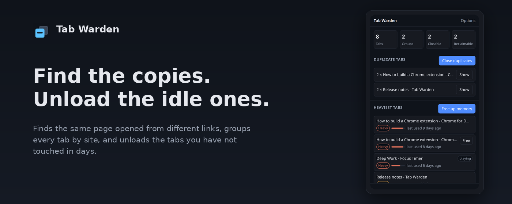

<div align="center">


<h1>Tab Warden</h1>

<p><strong>A Chrome extension that finds duplicate tabs, groups every open tab by site, and unloads the tabs you have not touched in days.</strong></p>

<p></p>

<p>
<a href="https://developer.chrome.com/docs/extensions/mv3/intro"></a>
<a href="https://developer.chrome.com/docs/extensions/mv3/intro"></a>
<a href="https://developer.mozilla.org/en-US/docs/Web/JavaScript"></a>
<a href="https://vite.dev/"></a>
<a href="https://www.npmjs.com/"></a>
<a href="https://developer.chrome.com/docs/extensions/mv3/intro"></a>
<a href="https://developer.chrome.com/docs/extensions/mv3/intro"></a>
<a href="https://github.com/RehanIlyas-dev/Tab-Warden/releases"></a>
<a href="https://vitest.dev/"></a>
</p>

<p>
<a href="https://rehanilyas-dev.github.io/Tab-Warden/"></a>
<a href="https://rehanilyas-dev.github.io/Tab-Warden/#privacy"></a>
</p>

</div>

---

## The problem

Chrome degrades quietly. You open the same article from a newsletter, then from
search, then from a link in Slack, and end up with nine tabs pointing at one page.
Memory climbs and nobody can tell which tab is responsible.

Chrome's built-in tools do not surface this. Task Manager shows memory but cannot
tell you that nine of those tabs are the same page.

Tab Warden answers one question: what is costing me right now, and what can I close.

## Features

| Feature               | What it does                                                |
| --------------------- | ----------------------------------------------------------- |
| **Duplicate finder**  | Groups tabs by normalized URL and closes the copies          |
| **All tabs by site**  | Every open tab, grouped by domain, click to focus            |
| **Tab weight**        | Rates each tab by how long it has been idle and what it does  |
| **Free up memory**    | Unloads idle background tabs, they reload when you go back   |
| **Daily clean up**    | Does the same on its own once a day, if you turn it on       |
| **Guarded closing**   | Never closes the active tab or your pinned tabs              |

Everything here is covered by 205 unit tests, and the extension asks for only three
permissions: `tabs`, `storage` and `alarms`.

## Using it

Open the toolbar icon. Four stat cards, then three lists:

- **Duplicate tabs**, one row per group, showing how many copies exist. The
  **Show** button jumps to that tab and raises its window.
- **Heaviest tabs**, the tabs that are costing the most, each with a weight and
  how long you have not touched it. **Free** unloads one tab, and **Free up
  memory** unloads all the idle ones at once.
- **All tabs**, every open tab grouped by domain, most recent first. Click any row
  to jump to it. Rows tagged `pinned` are kept by default, and the tab you are
  looking at is never closed.

**Close duplicates** and **Free up memory** both show an inline confirmation,
then report how many were done and how many were kept.

The weight is an estimate, not a memory reading. Chrome does not hand extensions
a real memory figure for a tab, so the rating comes from how long a tab has been
idle, whether it is playing audio, and whether it is a duplicate. Unloading frees
the memory and the tab reloads when you click it, so anything you had not saved
on that page is lost.

Options holds the switches: keep pinned tabs, ask before closing, how many days
count as stale, leave tabs that are playing audio alone, and turn the daily clean
up on or off. The daily run uses the same rules as the button, and it never
touches a tab you are looking at in any window.

## Install

### Download the release

Grab
[`tab-warden-0.2.0.zip`](https://github.com/RehanIlyas-dev/Tab-Warden/releases/download/v0.2.0/tab-warden-0.2.0.zip),
unzip it, then open `chrome://extensions`, turn on **Developer mode**, click
**Load unpacked**, and pick the unzipped folder. No build step needed.

### Extracting the archive on Linux

If you downloaded the `.tar.gz` archive instead of the zip:

```sh
tar -xzf tab-warden-0.2.0.tar.gz
```

`-x` extracts, `-z` decompresses gzip, and `-f` names the file. You get a
`tab-warden-0.2.0` folder, which is the one you pick in `chrome://extensions`
with Developer mode on.

### From source

```sh
git clone https://github.com/RehanIlyas-dev/Tab-Warden.git
cd Tab-Warden
npm install
npm run build
```

Then open `chrome://extensions`, enable **Developer mode**, click **Load unpacked**,
and select the `dist/` folder.

### Web Store

Not published yet.

## Architecture

```
Tab-Warden/
├── public/manifest.json
├── public/assets/icon-16.png
├── scripts/make-icons.py
├── scripts/make-store-assets.py
├── docs/
│   ├── index.html
│   └── screenshot.png
├── popup.html
├── options.html
├── vite.config.js
├── src/
│   ├── background/service-worker.js
│   ├── lib/tab.js
│   ├── lib/focus.js
│   ├── lib/messages.js
│   ├── lib/sweep.js
│   ├── lib/weight.js
│   ├── popup/main.js
│   ├── popup/style.css
│   └── options/main.js
└── test/
    ├── tab.test.js
    ├── service-worker.test.js
    ├── focus.test.js
    ├── sweep.test.js
    ├── weight.test.js
    ├── bundle-test.mjs
    ├── crash-probe.mjs
    ├── dom-stub.js
    └── fake-chrome.js
```

## Tech

Plain JavaScript (ES2022), Manifest V3, Vite, no UI framework, zero runtime
dependencies.

## Privacy

Everything runs on your device. There is no server, no analytics, and no
telemetry, and the extension makes no network requests. The full policy is on
the project site:

https://rehanilyas-dev.github.io/Tab-Warden/#privacy

## Contributing

Issues and pull requests welcome.

```sh
npm run build
npm test
```

`npm run check` runs all three layers: the unit tests, the crash pass that
throws hostile input at the code, and the check of the built extension.

Keep logic that can be tested in `src/lib/`. Avoid adding runtime dependencies.
